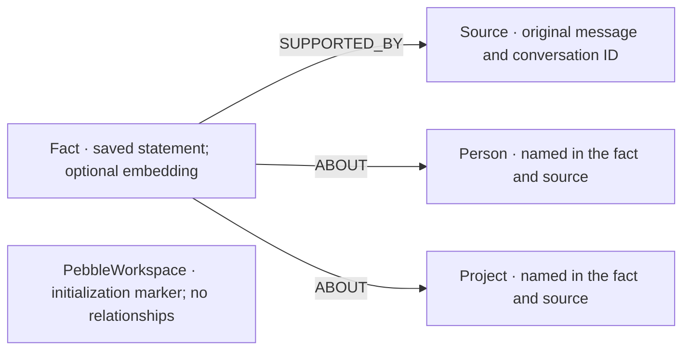

# pebble

A local personal assistant with a character you name, durable conversations, source-backed graph memory, tools and turn-based voice. Built with Next.js, TypeScript, Bun, **Pi Durable Harness 1.2.0** and **FalkorDB**. The original character playground is at `/`; the functional workspace is at `/home`.

## Run locally

```sh
bun install
# Optional local FalkorDB; alternatively configure your own Cloud/server graph.
docker compose -f compose.falkordb.yml up -d
# Terminal one: one process owns durable storage
bun run runtime
# Terminal two
bun run dev --port 7341
```

Open http://127.0.0.1:7341/home. The owner binds only `127.0.0.1:7342`; the proxy accepts `localhost:7341` / `127.0.0.1:7341`. Check ports first; do not kill unrelated listeners. Port 3000 is not used.

1. Save your character.
2. Sign in with ChatGPT, or configure your own OpenAI, Anthropic, Google/Gemini or supported OpenRouter API key/model. API inference may incur the selected provider's charges. ChatGPT uses a fresh app-specific device UUID, not imported Codex credentials; its callback uses port 1455.
3. Connect FalkorDB. For the provided local container: host `127.0.0.1`, port `7380`, graph `pebble`, blank username/password, TLS off. Explicitly initialize the graph on first setup. Cloud uses your own settings and TLS. Connecting syncs saved eligible conversation sources into that graph.
4. Send a message. Optional app connections, folder grants and microphone consent remain yours to configure; a fresh clone contains no account credentials or private data.

On macOS, supported provider credentials use the OS Keychain. Discord token persistence is opt-in. Passwordless graph configuration restores on restart; database passwords and Gmail settings/tokens remain session-only. Character, conversation/task storage and source-sync outbox live under ignored `.pebble/`. Never publish that directory. See [provider persistence](docs/provider-persistence.md), [Gmail setup](docs/gmail-setup.md) and [local database setup](docs/local-memory.md).

## Implemented and verified

| Capability | Working behavior and evidence boundary |
| --- | --- |
| Assistant execution | Real Pi Durable Harness; streamed committed replies, SQLite history, abort/resume, task persistence, native tools and automatic compaction. Compaction status is visible; a real Harness test verifies original history after compaction/reopen. |
| FalkorDB memory | Source-backed facts, Person/Project links, hybrid local semantic/lexical retrieval and configurable multi-hop context. Inspect sources, edit/delete facts, reject stale edits and reconnect across sessions. Real database and real-model synthetic-data checks passed. **[Graph model, actual queries and decision evidence](docs/graph-memory.md).** |
| Local files and private work | Explicit folder grants; Pi-native read/create/edit, file/text search and bounded private background tasks. Real-model synthetic file read/edit/create checks passed. Optional commands require exact review and run in disposable copies. No folders are granted by default. |
| Public browser research | Actual sandboxed hidden Chromium with a fresh anonymous profile, public navigation/link following, observations and optional screenshots. A live Noida-events task returned five dated source links. Routine navigation and ordinary links run without per-click review. Account browsing uses a separate profile; consequential changes require review. [Limits](docs/browser.md). |
| In-app voice | Local Whisper transcription → existing Pi conversation/tools/memory → macOS speech file. Record/Stop/End controls; playback only on user action. Synthetic audio through the real model and restored text history passed. Owner microphone/acoustic/playback verification remains pending. Requires existing local speech tools; no automatic download or cloud audio fee. [Setup and limits](docs/local-voice.md). |
| Discord | Owner-scoped mentions, channel memory/history, ordinary replies, private-work handoff and opt-in requested reminders/completion notices. A saved bot connection is operational on the development Mac; fresh clones require their own bot setup. Delivery/notification regressions use isolated transports. No private channel IDs or tokens are included. |
| Gmail | OAuth, bounded mailbox search/read, summary/reply context handoff, reviewable outbound messages and incremental intake via manual checks, local Pub/Sub pull or authenticated hosted push. Google OAuth and Gmail profile connection verified on the development Mac, with approved read/send scopes. Mailbox content search/read and sending remain unverified live; fixture checks cover them. Fresh setups require Google consent. |
| Character and chat UI | Original parameterized SVG customizer, accessible controls, local persistence, safe Markdown, code highlighting/copy, tables, source inspection and bounded image inputs. Desktop/mobile checks passed. |

Voice is turn-based, not phone/SMS or a continuous interruptible realtime call. There is no multi-user hosting, recurring autonomous monitor or full desktop control. Reviews remain for consequential sends/actions; ordinary authorized reads/searches/public research do not require repeated approval. See [current status](docs/product-status.md) and [execution boundaries](docs/assistant-capabilities.md). Landing illustrations remain a design preview; the workspace is the functional application.

## Graph and verification

FalkorDB supplies remembered facts used in the model's next response; it is not just a connection badge or a transcript stored as opaque text. SQLite handles durable execution/transcripts separately. Native semantic mode currently uses the Mac’s English sentence model; unsupported hosts visibly retain wording and graph recall. The [graph explanation](docs/graph-memory.md) shows the Source/Fact/Person/Project model, native vector search, multi-step queries and synthetic paraphrase/relationship checks. A paraphrase can retrieve a bicycle repair fact without shared wording; a lookup in fictional CobaltRelay test data follows Liora → BirchLedger → Noor to an after-lunch preference. Real-model answers cited the source facts and described the indirect relationship accurately.

### The memory graph



These arrows are the stored edge directions. A fact can link to a person, a project, both or neither; every saved fact keeps its supporting source. Roles such as “leads” or “reviews” remain in the fact's text, rather than becoming invented relationship types.

For each owner chat request, pebble retrieves matching graph facts before generating the answer. The agent can also call `pebble_memory_search`. Retrieval combines wording and local sentence-vector matches, then follows shared Person/Project nodes to related facts, up to three expansion steps by default. Each result carries its original source and, for connected results, its traversal path. The graph therefore changes which context reaches the model; SQLite separately preserves conversation and execution history. A shared entity supplies context, not proof of a new relationship.

This representative query shows one expansion from a matched fact (`$seed0` is its ID):

```cypher
MATCH (seed:Fact {id: $seed0})-[:ABOUT]->(entity)<-[:ABOUT]-(related:Fact)
MATCH (related)-[:SUPPORTED_BY]->(source:Source)
WHERE seed.id <> related.id
RETURN DISTINCT related.text AS fact, entity.name AS connectedThrough,
                source.id AS sourceId, source.text AS sourceText
LIMIT 16
```

**Fictional demo/test data:** Liora, Noor, CobaltRelay and BirchLedger are invented names used in the tests, not real people or projects. Save separately sourced facts saying Liora leads CobaltRelay, Liora coordinates BirchLedger, Noor reviews BirchLedger, and Noor is available after lunch. A CobaltRelay lookup can follow the shared entities Liora → BirchLedger → Noor and surface the review-time preference. Show **Memory → Search saved facts → Connection path** and the original source beside the answer. Explain that Noor's connection to CobaltRelay is indirect: the graph does not assert that Noor reviews CobaltRelay. The existing synthetic graph and agent tests exercise this scenario; a same-conversation answer alone is not proof of graph retrieval.

```sh
bun run typecheck
bun run test:runtime
bun run runtime/memory-real-smoke.ts
bun run build
```

Use an isolated build directory if the preview is running: building over its `.next` can disrupt it. Runtime browser tests require installed sandbox-capable Chromium. The real voice test runs only when local speech tools are available; it generates files silently, never microphone capture or speaker playback. The memory smoke check requires the local database at port 7380 and creates/deletes a uniquely named synthetic graph. It never selects the personal graph.

Checks include isolated model/provider transports and actual local Chromium/FalkorDB. Separate bounded real ChatGPT/Pi checks verified public research, synthetic file actions, graph-grounded answers and the local voice pipeline; temporary test app data and graphs were removed. New BYOK provider inference and a live Gmail account are not claimed without credentials. Older UI scripts that assume disconnected setup must not target a connected owner; see [copy verification guidance](docs/ui-copy.md).

## Assets and project scope

Original SVG/design; Lucide icons (ISC); DM Sans/Manrope (SIL Open Font License) with system/Georgia fallbacks. No paid assets or hosted audio provider are needed. This is a local single-owner application, not a public multi-user service. Follow [project workflow](AGENTS.md) and [UI copy guidance](docs/ui-copy.md).
